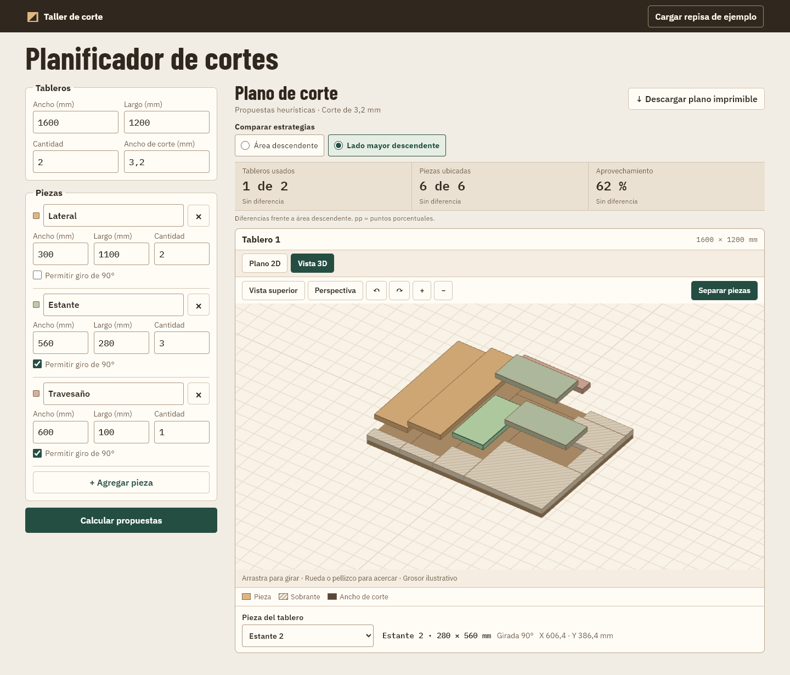

# Planificador de cortes

Aplicación en español para distribuir piezas rectangulares en tableros de madera y comparar dos propuestas de corte. El cálculo se ejecuta en el navegador con un motor TypeScript independiente de React.

[Abrir la demo](https://humiumii.github.io/planificador-de-cortes/)



[Ver el plano 2D de la repisa](docs/taller-escritorio.png)

## Ejecutar en local

Requiere Node.js 24 y npm.

```sh
npm ci
npm run dev
npm test
npm run build
npm run preview
```

`npm run build` genera el sitio estático en `dist/`. El flujo de GitHub Actions ejecuta las pruebas y el build antes de publicar en GitHub Pages.

## Usar el planificador

1. Ingresa el ancho y largo de los tableros en milímetros, la cantidad disponible y el ancho de corte.
2. Agrega las piezas con sus dimensiones, cantidad y permiso de giro. Desactiva el giro si necesitas conservar la orientación.
3. Calcula las propuestas y selecciona la que quieres inspeccionar. El plano identifica las piezas, los sobrantes y el material que consume la sierra.
4. Selecciona una pieza en el plano o en la lista. Cambia entre **Plano 2D** y **Vista 3D** para inspeccionar el mismo tablero con la misma pieza seleccionada.
5. Descarga el plano elegido como HTML autónomo. Ábrelo en el navegador para imprimirlo en A4 o guardarlo como PDF. Incluye las medidas, la lista de piezas, las piezas pendientes y el dibujo de cada tablero usado. Las cotas están en milímetros y el dibujo conserva las proporciones al imprimirse.

La repisa precargada usa un tablero de 1600 × 1200 mm en ambas propuestas y ubica las 6 piezas con un 62 % de aprovechamiento. Por área, el travesaño queda girado debajo de un estante. Por lado mayor, queda horizontal encima de los estantes.

## Inspeccionar en 3D

Arrastra sobre el tablero para girar la cámara y usa la rueda o el gesto de pellizco para acercar. Los botones permiten girar y acercar sin gestos, y **Vista superior** encuadra el tablero desde arriba. Usa **Separar piezas** para levantarlas sobre su posición original y pulsa de nuevo para devolverlas al plano.

La escena Three.js se carga con React Three Fiber al abrir la vista. Las piezas, sobrantes y franjas de corte se dibujan con las dimensiones y coordenadas calculadas. El grosor y la altura de separación son ilustrativos. Con movimiento reducido, las piezas cambian de altura sin animación. Si WebGL 2 está desactivado o el contexto se pierde, la aplicación ofrece el plano 2D de la propuesta activa.

## Estrategias y límites

- **Área descendente** coloca primero las piezas con mayor producto de ancho por largo.
- **Lado mayor descendente** prioriza las piezas con el lado más largo.
- Ambas usan los mismos tableros, piezas y ancho de corte. Prueban primero los tableros ya abiertos y eligen, dentro del primer tablero que sirve, el sobrante compatible con menor área libre después de ubicar la pieza. Consideran el giro solo si está permitido. El orden de ingreso y recorrido resuelve empates de forma determinista.
- Cada colocación puede dividir el rectángulo libre con hasta dos cortes de guillotina, uno por eje. Cada pasada atraviesa de borde a borde el rectángulo que se divide y consume el ancho configurado. El primer corte se elige para conservar el mayor sobrante rectangular de borde a borde. Un encaje exacto en un eje no necesita corte en ese eje. Si queda una franja menor que el ancho de corte, se descarta ese encaje.
- El aprovechamiento es el área de las piezas ubicadas dividida por la superficie total de los tableros usados. El plan indica si quedan piezas pendientes. Los resultados son heurísticos y pueden dejar piezas fuera aunque exista otro acomodo que logre ubicarlas.
- Esta versión admite un formato de tablero por cálculo, medidas de hasta dos decimales, hasta 100 tableros y 1000 piezas. El modelo supone tableros rectangulares sin defectos y no incluye márgenes de saneado ni una hoja con la secuencia de pasadas.
